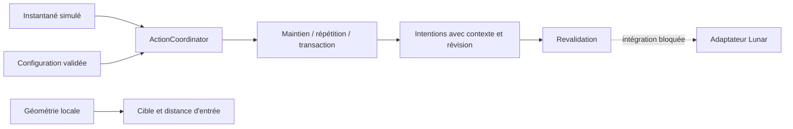

# Architecture et frontières vérifiables

| Composant proposé | Réalisation actuelle |
|---|---|
| NativeRuntime | Admission de rappels, arrêt irréversible, attente de fin des rappels ; pas de chargeur |
| JvmContext | RAII dans le diagnostic autonome : JavaVM partagé, JNIEnv obtenu et utilisé par thread ; seuls les threads attachés ici sont détachés |
| MappingRegistry | Absent ; aucune table n'est activée et aucun identifiant client n'est déclaré |
| ClassResolver | Résolution du diagnostic par le ClassLoader Java fourni ; noms standard Java et classe du laboratoire uniquement |
| ApplicationAdapter | Absent ; opérations et thread applicatif Lunar non vérifiés |
| SnapshotReader | Absent ; tests fournissent des valeurs cohérentes, pas une lecture atomique du client |
| ActionCoordinator | Désarmement, priorités, échéances monotones, réservation d'équipement et revalidation |
| Modules | Fonctions du cœur ; séparation en bibliothèques indépendantes non nécessaire à ce stade |
| Configuration | Structure C++ avec validation ; repeat=100 ms, timeout=500 ms, seuil=.15, portée=3 |
| Diagnostics | Rapport de compatibilité, tests à échecs explicites et diagnostic JNI autonome |

## Transactions

`Idle → AwaitingConfirmation → Idle` si un nouvel instantané confirme l'identité
attendue. À expiration : `AwaitingConfirmation → Reobserve`, sans nouvel ordre.
Une révision d'inventaire strictement supérieure à celle observée à l'expiration,
avec inventaire disponible et curseur vide, autorise une nouvelle décision.
Une confirmation tardive est donc observée avant un éventuel nouvel ordre.
Un changement de contexte annule la transaction locale. Une opération déjà
envoyée ne peut pas être annulée rétroactivement ; aucun rollback aveugle n'est prévu.

Le modèle suppose des identités d'objets uniques et des révisions cohérentes.
L'intégration devra confirmer également slot, contenu, identité, état du curseur,
révision et réponse du serveur. La transaction simplifiée n'est pas un protocole
de clic d'inventaire Minecraft prêt à déployer.

## Temps et exécution

Le type d'horloge est `steady_clock`. Les tests injectent ses points temporels sans
attendre les délais de jeu. Après émission, l'échéance suivante est `maintenant + période` :
aucune boucle de rattrapage. Un recul temporel désarme le coordinateur.
Les instantanés doivent être frais et cohérents ; cette propriété n'est pas prouvée
par la structure C++ seule. Le coordinateur n'est pas multithread et doit rester sur
un unique thread applicatif vérifié ; seul NativeRuntime est synchronisé.

## Contrat JNI avant toute intégration

Le chargeur autorisé doit charger explicitement la bibliothèque. Résoudre ensuite
la JVM, le ClassLoader correct, la build et les descripteurs versionnés, sans assimiler
`jfieldID`/`jmethodID` à des offsets. Chaque thread obtient son propre JNIEnv.
Les références globales doivent être supprimées avant l'arrêt de la JVM ; chaque
trame locale est bornée. Toute exception JNI doit interrompre l'opération concernée.
Le diagnostic efface uniquement l'exception attendue pour sa classe inexistante,
ou les erreurs qu'il transforme en résultat d'échec ; il n'affiche aucune pile client.

## Arrêt

1. Interdire toute nouvelle action ; libérer les réservations détenues.
2. Fermer l'admission de rappels et désenregistrer les rappels auprès de l'hôte.
3. Joindre les workers appartenant au composant.
4. Attendre les rappels déjà admis, depuis un thread extérieur à ces rappels.
5. Libérer les références JNI dans une JVM encore valide.
6. Décharger seulement si l'hôte garantit qu'aucun rappel ne peut encore entrer.

La barrière seule ne garantit pas le point 6 : un hôte conservant un pointeur vers
une DLL déchargée resterait dangereux. Le diagnostic joint son worker avant de
retourner et laisse la JVM terminer ; aucun déchargement dynamique Lunar n'est testé.
